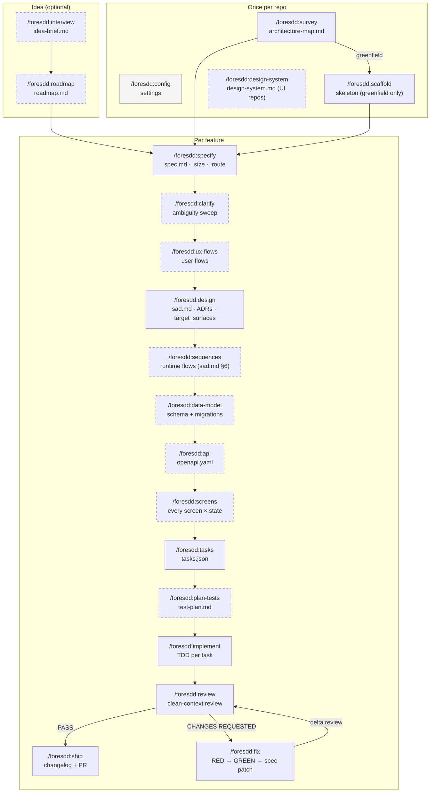

# foresdd — Spec-Driven Development (SDD) for Claude Code

foresdd is a Claude Code plugin that runs a feature from a rough idea to a merged pull request
through a fixed sequence of reviewed documents: **spec → architecture → contracts → tasks → tested
code → review → PR**. Each stage is a slash command (`/foresdd:<stage> <slug>`). It reads the
artifacts the previous stage left on disk, asks you about the decisions it can't make alone, writes
its own artifact, commits it, and prints the exact command to run next.

## Contents

- [What Spec-Driven Development means here](#what-spec-driven-development-means-here)
- [The flow](#the-flow)
- [Install in Claude Code](#install-in-claude-code)
- [How to configure](#how-to-configure)
- [How to run (first run)](#how-to-run-first-run)
- Recipes:
  [new backend feature](#new-backend-feature) ·
  [update an existing backend feature](#update-an-existing-backend-feature) ·
  [UI feature](#ui-feature) ·
  [bug fix](#bug-fix) ·
  [fix or change a feature's behaviour](#fix-or-change-a-features-behaviour) ·
  [backend feature with a strict TDD flow](#backend-feature-with-a-strict-tdd-flow)
- [Credits](#credits)

## What Spec-Driven Development means here

In SDD the spec is the source of truth and the code is derived from it. foresdd follows these rules:

- **Every line of code traces back to an acceptance criterion (AC).** `spec.md` §5 lists the ACs.
  Tasks cite them, tests assert them, and each commit carries `SDD-Task:` / `SDD-AC:` trailers, so
  you can go from any AC to the commit that implemented it.
- **Each stage has a gate.** A stage hard-refuses when its input is missing. For example,
  `implement` won't start without `tasks.json`, and `api` won't start before `data-model` when the
  schema changes. Ordering problems surface right away.
- **Contracts are derived.** The OpenAPI contract comes from the data model, the sequence diagrams
  and the ACs, and then gets checked for drift against them. Nobody writes it by hand.
- **Code is test-first.** Every task runs `RED → GREEN → REFACTOR → GATE → COMMIT`. The first test
  run has to fail on the right assertion before any production code is written.
- **Effort scales with size.** A feature gets a T-shirt size (XS–XL) and a route
  (`quick` / `standard` / `full`). Small features skip the stages that don't apply to them. Large
  features get the full artifact set.
- **Independent judges check the work.** The critic, devil's advocate and reviewer agents run in a
  clean context, so they review the document on disk without the conversation that produced it.
- **A bug counts as evidence against the spec.** `fix` pins the bug with a failing test, then
  patches the AC that allowed it so the same class of bug can't come back.

Every artifact lives in your repo under `docs/`. The per-feature artifacts go in
`docs/features/<slug>/`:

```text
docs/
├── architecture-map.md        # survey: how the repo is built (read by every later stage)
├── design-system.md           # design-system: design tool, posture, component inventory (UI repos)
├── idea-brief.md              # interview (optional)
├── roadmap.md                 # roadmap (optional)
└── features/<slug>/
    ├── spec.md  .size  .route # specify (+ clarify tightens it)
    ├── ux-flows.md            # ux-flows (UI features)
    ├── sad.md  adr/           # design (+ sequences fills §6)
    ├── data-model.md  migrations/   # data-model (staged; implement promotes them)
    ├── contracts/openapi.yaml       # api
    ├── screens.md             # screens (UI features)
    ├── tasks/  tasks.json     # tasks
    ├── test-plan.md           # plan-tests (inline in spec.md for XS/S)
    ├── _review/  _fixes/      # review, fix
    └── changelog.md           # ship
```

## The flow



Solid boxes are the **backbone**, which runs on every route:
`specify → design → tasks → implement → review → ship`. Dashed boxes are **optional stages**. Each
one is skipped only when its N/A condition holds:

| Stage | Skipped when | Typically needed for |
|---|---|---|
| `clarify` | the spec has zero open questions and no ambiguous AC | anything non-trivial |
| `ux-flows` | no human-facing UI (every actor is a system or service) | UI features |
| `sequences` | one actor and no multi-step runtime flow | multi-step backend flows |
| `data-model` | no new entity, column, index or migration | schema changes |
| `api` | no new or changed endpoint, event, CLI command or public signature | API changes |
| `screens` | `sad.md` declares no UI surface | UI features |
| `plan-tests` | never skipped. For XS/S it collapses into an inline `## Test plan` in `spec.md` | always |

The **route** controls how those skips happen. `specify` proposes a size and a route and you confirm
both, or you change them later with `/foresdd:tshirt-size <slug>`:

| Route | Default for | What happens at an optional stage |
|---|---|---|
| `quick` | XS / S | Auto-skipped when N/A. The handoff says why and offers to run the stage anyway |
| `standard` | M | You're offered the skip at each handoff and you choose |
| `full` | L / XL | Nothing is skipped |

Any stage you invoke directly still runs, whatever the route says.

**Utilities** can run at any point: `/foresdd:glossary` (domain terms in `CONTEXT.md`),
`/foresdd:decide-adr` (record a decision made outside `design`), `/foresdd:tshirt-size` (re-size or
re-route a feature) and `/foresdd:config` (tune settings).

**Each stage ends with a handoff block.** It contains a status marker (✅ / ⚠️ / ⛔), a pipeline
trail such as `specify ✓ → clarify ↷ → design ▶ → …`, what was written and committed, what needs
your attention, the files to review, and the next command. That next command is ready to copy:

```text
/clear                      ← recommended: the next stage re-reads everything from disk
/foresdd:design my-feature
```

## Install in Claude Code

**Requirements:** Claude Code with plugin support, and a git repository for the project you want
to work on. Optional extras:

- Docker, for integration tests during `implement`
- [`mmdc`](https://github.com/mermaid-js/mermaid-cli), for full Mermaid validation
- the Figma or Pencil MCP server, for `screens`

foresdd works without any of these. It falls back and tells you what it skipped.

Add the marketplace and install the plugin from inside Claude Code:

```text
/plugin marketplace add bohdanlisovskyi/foresdd
/plugin install foresdd@foresdd
```

Restart Claude Code if it asks you to, then check that the commands loaded. Typing `/foresdd:`
should list the stages.

To install from a local clone instead, for example while you're working on the plugin:

```bash
git clone https://github.com/bohdanlisovskyi/foresdd.git
```

```text
/plugin marketplace add ./foresdd
/plugin install foresdd@foresdd
```

To update to a newer version:

```text
/plugin marketplace update foresdd
```

## How to configure

All settings live in one per-developer file, `.claude/sdd.local.md`. The first pipeline stage you
run creates it with documented defaults. That stage also adds `.claude/*.local.md` and
`.worktrees/` to `.gitignore`. The file itself is never committed.

The defaults work out of the box, so you don't have to configure anything. To review or tune them:

```text
/foresdd:config                 # show current settings, then keep / walk all groups / change one group
/foresdd:config depth           # jump straight to one group: depth | model | gates | execution
```

You can also state a change in plain words. Changes like these are applied without any questions:

```text
/foresdd:config set interview depth to hard
/foresdd:config turn off the lint gate
/foresdd:config put the judges on sonnet
/foresdd:config don't commit for me
```

The settings are organised in four groups:

| Group | Keys | Default | Main options |
|---|---|---|---|
| **Interview depth** | `interview_depth` | `medium` | `easy` asks only what it can't infer and lists its assumptions for you to veto. `hard` walks every decision. Each feature records its depth in `.depth`. To override for one run, pass `--depth=` or say "deeper" / "faster" |
| **Model tier** | `judgment_model`, `model_<role>`, `effort_<role>` | judges on opus, executors on sonnet, effort raised automatically on L/XL | "Everything on sonnet" (for accounts without Opus) · "Inherit the session model" · "Judges on fable" |
| **Tests and gates** | `tdd`, `stop_on_red`, `max_red_retries`, `gate_lint`, `gate_vet`, `require_integration` | TDD on, stop on red after 3 retries, lint + vet on, integration `auto` (runs when Docker answers) | "Don't stop on red" · "Light gates" (unit tests only) · "No TDD" |
| **Execution and commits** | `team_mode`, `workflow_mode`, `max_parallel_agents`, `isolation`, `auto_commit`, `branch_strategy` | the engine picks sequential or parallel from the task graph · up to 3 agents, each in its own git worktree · a commit per task on a feature branch | "Agent team" · "Strictly sequential, one stream" · "Leave commits to me" (`auto_commit: off` prints the commit commands instead) |

Leave the test, lint and vet commands (`cmd_test_unit`, `cmd_test_integration`, `cmd_lint`,
`cmd_vet`) empty. They're detected from your Makefile, package scripts or language manifests. Fill
one in only when detection picks the wrong command. You can also edit the file by hand: every key
has a comment explaining it, and `/foresdd:config` keeps your comments and any unknown keys intact.

## How to run (first run)

Run these once per repository. Then follow the [recipe](#new-backend-feature) that matches your task.

**1. Map the repository.**

```text
/foresdd:survey
```

- **Existing codebase:** `survey` scans the code once and writes `docs/architecture-map.md`. The
  map covers the C4 view of what exists, the modules, the conventions (with `file:line` evidence),
  the datastores, the frontend if there is one, and the build/test/lint commands. It summarises the
  map in prose and asks you to confirm before committing. Later stages read this map instead of
  re-scanning. Re-run `survey` when the code has moved on, and it updates only the parts that
  changed.
- **Empty repository:** `survey` runs a short foundation session. You choose the stack, folder
  structure, data approach and conventions together, and it records those choices as foundational
  ADRs. Then build the skeleton:

  ```text
  /foresdd:scaffold
  ```

  This creates the folders, entry point, test harness with a smoke test, migration tooling, CI and
  a conventions doc, and checks that the smoke test is green.

**2. (Optional) Tune settings:** `/foresdd:config`. Skip this step to keep the defaults.

**3. (Optional) Set up the design canon if the product has a UI:** `/foresdd:design-system`. It
picks the design tool (Figma MCP, Pencil MCP or plain markdown), the platform posture and the token
source, and records the component inventory that new screens reuse.

**4. (Optional) Shape a fuzzy idea before writing a spec:**

```text
/foresdd:interview my-idea      # stress-tests the idea → docs/idea-brief.md
/foresdd:roadmap                # breaks it into sized steps and parallel waves → docs/roadmap.md
```

**5. Start your first feature:** `/foresdd:specify <slug>`. Pick a short kebab-case slug such as
`order-refunds`. From here on, follow the handoff block at the end of each stage.

> **Tip:** run `/clear` between stages, as the handoff recommends. Each stage re-reads everything
> it needs from disk, so a fresh context costs less and avoids stale assumptions.

## Recipes

The recipes below show the complete sequence of commands. In practice you don't need to remember
them: each stage's handoff names the next command, and on a `quick` route the stages that don't
apply are skipped for you.

### New backend feature

Example: a new REST endpoint with a new table, for an M-sized feature on the `standard` route.

```text
/foresdd:specify order-refunds      # idea → spec.md (user stories, ACs, NFRs, KPIs); proposes size + route
/foresdd:clarify order-refunds      # devil's-advocate ambiguity sweep; tightens the ACs
/foresdd:design order-refunds       # sad.md (Arc42 + C4 L1/L2) + ADRs; declares target_surfaces: [backend-service]
/foresdd:sequences order-refunds    # Mermaid sequence diagrams for each critical flow (happy + error paths)
/foresdd:data-model order-refunds   # data-model.md + staged *.up.sql / *.down.sql migrations
/foresdd:api order-refunds          # contracts/openapi.yaml derived from the data model + flows + ACs
/foresdd:tasks order-refunds        # ≤1-day tasks, dependency graph, per-task Definition of Done → tasks.json
/foresdd:plan-tests order-refunds   # maps every AC to at least one test and a test level
/foresdd:implement order-refunds    # TDD per task, gates, one commit per task on a feature branch
/foresdd:review order-refunds       # clean-context review: AC compliance first, then code quality
/foresdd:ship order-refunds         # re-runs the gate, verifies the feature for real, writes the changelog, proposes the PR
```

- `ux-flows` and `screens` are skipped because the feature has no UI surface.
- On a `quick` XS/S feature with no schema or contract change, the chain shortens to
  `specify → design → tasks → implement → review → ship`.
- `implement` prints a banner with the mode, the resolved models, the detected commands and the
  task waves, then asks **Start / Change settings first / Dry run only** before it writes anything.
- If `review` returns `CHANGES REQUESTED`, run `/foresdd:fix order-refunds` for each localised
  finding or `/foresdd:implement order-refunds` for task-sized ones. Then run
  `/foresdd:review order-refunds` again. That second review is a delta review of only what changed.
- `ship` never merges. Merging to `main` is your decision.

### Update an existing backend feature

Example: adding partial refunds to the `order-refunds` feature that has already shipped.

**1. Refresh the map** so the design reflects the code as it is now. Only the changed modules are
re-scanned:

```text
/foresdd:survey
```

**2. Choose where the change lives.**

- **The feature has shipped** (recommended): give the change its own slug. It gets its own spec,
  ADRs, tasks and PR, and its own clean history of ACs and commits:

  ```text
  /foresdd:specify order-refunds-partial
  ```

  In the spec, reference the original feature. `design` reads the architecture map and existing
  ADRs, so the new SAD builds on what already exists. `data-model` writes only the delta
  migrations. `api` updates the existing contract conventions instead of inventing new ones.
- **The feature hasn't shipped yet** (still being specified or built): revise it in place.

  ```text
  /foresdd:specify order-refunds
  ```

  `specify` sees the existing `spec.md` and asks whether to **Revise this spec** (keep it as the
  baseline and walk only what you want changed), **Restart from the template** (the old version
  stays in git) or **Stop** and sharpen it with `clarify` instead. It never overwrites the file
  without asking.

**3. Continue down the backbone as usual:**

```text
/foresdd:clarify     order-refunds-partial
/foresdd:design      order-refunds-partial
/foresdd:sequences   order-refunds-partial    # if the runtime flow changes
/foresdd:data-model  order-refunds-partial    # if the schema changes
/foresdd:api         order-refunds-partial    # if the contract changes
/foresdd:tasks       order-refunds-partial
/foresdd:plan-tests  order-refunds-partial
/foresdd:implement   order-refunds-partial
/foresdd:review      order-refunds-partial
/foresdd:ship        order-refunds-partial
```

For a decision that was made outside `design`, for example in a chat or directly in code, record
it with `/foresdd:decide-adr order-refunds-partial "<decision title>"`.

### UI feature

Example: a refunds page in the web app, sized M or larger. Run `/foresdd:design-system` once per
repo before your first UI feature. `ux-flows` recommends it if `docs/design-system.md` is missing.

```text
/foresdd:specify   refund-request-page   # include a human actor in the user stories
/foresdd:clarify   refund-request-page
/foresdd:ux-flows  refund-request-page   # one Mermaid flowchart per UI user story + screen inventory (SCR-NN) + AC→flow map
/foresdd:design    refund-request-page   # declares target_surfaces, e.g. [backend-service, web-frontend]
/foresdd:sequences refund-request-page
/foresdd:data-model refund-request-page  # if the schema changes
/foresdd:api       refund-request-page   # if the contract changes
/foresdd:screens   refund-request-page   # every screen in every state: default / loading / empty / error / success / validation
/foresdd:tasks     refund-request-page   # adds `ui` tasks that reuse existing components and cite SCR-NN ids
/foresdd:plan-tests refund-request-page  # adds component / visual-regression / e2e-through-UI tiers
/foresdd:implement refund-request-page
/foresdd:review    refund-request-page
/foresdd:ship      refund-request-page
```

- `screens` draws with the tool chosen in `design-system`: Figma MCP into the canon file, Pencil
  MCP into `screens.pen`, or inline markdown wireframes. When the MCP server isn't available, it
  falls back to markdown wireframes.
- The UI surface is declared in `design`. Without it, `screens` and the `ui` task layer are
  skipped. If you expected them, re-run `design`.
- A feature that is UI-only, with no backend change, skips `data-model` and `api` on their N/A
  conditions.
- `implement` registers any new component it creates back into `docs/design-system.md`.

### Bug fix

Use this when the code doesn't do what the spec says:

```text
/foresdd:fix checkout-discounts discounts are applied twice when the user clicks pay twice fast
```

The slug is optional. `fix` finds the owning feature from the symptom. It then works through these
steps:

1. **Reproduce.** It asks one or two questions to get a one-line statement in the form "doing X,
   expected Y, got Z". If it can't reproduce the bug, it asks you for more details, or records the
   bug as `unreproduced` without changing any code. It never guesses at a fix.
2. **Triage against the spec.**
   - **Regression:** an AC covers the behaviour and the code violates it.
   - **Spec-bug:** the AC is ambiguous enough to allow the bug.
   - **Gap:** no AC covers the behaviour.
3. **RED.** It writes a minimal failing test that reproduces the bug, and confirms it fails on the
   expected-behaviour assertion.
4. **Checkpoint.** You confirm the root cause and the planned fix before any production code is
   written.
5. **GREEN + gate.** It applies the minimal fix, then runs unit, integration, lint and vet.
6. **Spec patch.** For a spec-bug or a gap, it updates the AC wording, or adds a new AC marked
   `added-by-fix`, after you confirm.
7. **Record.** It writes `docs/features/<slug>/_fixes/<date>-<short>.md` and commits with
   `SDD-Fix:` / `SDD-AC:` trailers.

If the fix touched more than 5 files or crossed a module boundary, the handoff also recommends
`/foresdd:review <slug>`. `fix` also works in a repo that has no specs at all: it fixes code-first
and recommends running `survey` afterwards.

### Fix or change a feature's behaviour

Use this when the code does what the spec says, but the spec is wrong or incomplete. Pick the path
by the size of the change.

**Small behaviour change** (one rule, one edge case, an AC that was worded loosely). Use `fix`:

```text
/foresdd:fix order-refunds refunds older than 30 days should be rejected, but nothing says so
```

`fix` triages this as a **gap** or a **spec-bug**. It asks you to confirm the AC change, which is a
product decision rather than a code decision. Then it writes the RED test for the new behaviour,
makes it pass, and patches `spec.md` in the same pass.

**Larger change** (new user stories, new endpoints, schema changes, several ACs). Use the
[update flow](#update-an-existing-backend-feature) instead: revise the spec with
`/foresdd:specify <slug>` → **Revise this spec**, or open a new slug, then continue down the
backbone. To sharpen the revised spec before designing, run:

```text
/foresdd:clarify order-refunds
```

**Reviewer findings** on a feature that hasn't shipped yet follow the review loop:
`/foresdd:fix <slug>` for each localised finding, `/foresdd:implement <slug>` for task-sized ones,
then `/foresdd:review <slug>`, which runs as a delta review.

### Backend feature with a strict TDD flow

TDD is on by default: every task already runs `RED → GREEN → REFACTOR → GATE → COMMIT`. Use this
recipe when you want the strictest version, with no step skipped and integration tests required.

**1. Tighten the gates for this repo:**

```text
/foresdd:config gates
```

Choose **"Full gates, stop on red"**. If integration tests must always run, also set:

```text
/foresdd:config require_integration=always
```

With `always`, `implement` refuses to start when Docker isn't available, instead of skipping the
integration tier.

**2. Run the feature on the `full` route,** so no optional stage is skipped and the test plan is a
separate file:

```text
/foresdd:specify     invoice-export      # pick route `full` in the size/route question
                                         # (or later: /foresdd:tshirt-size invoice-export)
/foresdd:clarify     invoice-export
/foresdd:design      invoice-export
/foresdd:sequences   invoice-export
/foresdd:data-model  invoice-export
/foresdd:api         invoice-export
/foresdd:tasks       invoice-export      # every task names the ACs it satisfies and its DoD
/foresdd:plan-tests  invoice-export      # test-plan.md: every AC → ≥1 test, levels, integration + data strategy
/foresdd:implement   invoice-export
/foresdd:review      invoice-export
/foresdd:ship        invoice-export
```

**3. Each task in `implement` follows this cycle:**

| Step | What happens |
|---|---|
| **SELECT** | Picks the next task whose dependencies are `done` on disk and reads its self-contained task file (ACs, data delta, API slice, edge cases) |
| **RED** | `test-author` writes the test first and runs it. The first run is classified out loud. **GOOD red** (fails on the assertion) moves on. **BAD red** (the test is broken) means fix the test. **False-pass** (green with no code) means strengthen the test. **NON-red** (skipped, e.g. no Docker) follows `require_integration`. The failing line is quoted before any production code is written |
| **GREEN** | `implementer` writes the least code that turns that assertion green, staying inside the task's files |
| **REFACTOR** | Cleans up while staying green. A refactor that goes red gets reverted |
| **GATE** | Unit, then integration, lint and vet must all be clean |
| **COMMIT** | A task-scoped commit with `SDD-Task: T<n>` and `SDD-AC: AC-<nn>` trailers |

If a test stays red, `implement` escalates. It tries a more capable model, retries, and then splits
the task. If the test turns out to encode a wrong AC, it asks you. **It never weakens the test.**
With `stop_on_red: true`, the run stops there. After that, `review` checks the whole diff in a clean
context and confirms that every AC has a test.

## Credits

foresdd is based on the [SDD workflow](https://github.com/genkovich/sdd) by
[Kyrylo Genkov](https://github.com/genkovich), released under the MIT License. The original
copyright notice is kept in [LICENSE](LICENSE).
