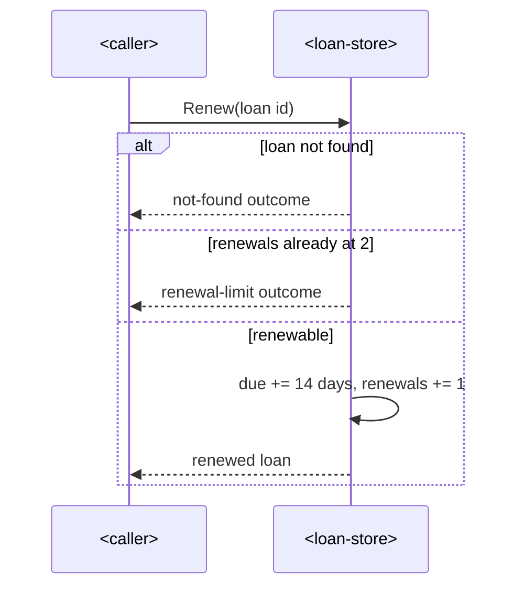

# SAD — loan-renewal

## 1. Introduction & goals

Members renew their own loans (spec US-1); extends the existing `internal/loan` module.

## 2. Constraints

Existing Go service (`example.com/library`, Go 1.22); in-memory store; no new deployment unit.

## 3. Context & scope

<!-- N/A: no new external actors. -->

## 4. Solution strategy

Target surface: `backend-service` (existing). Add a `Renew` operation to `internal/loan` with
the 14-day extension and the 2-renewal cap enforced in the domain, not the caller.

## 5. Building blocks

`internal/loan`: `Loan` gains a `Renewals int` field; `Store` gains `Renew(id string) (Loan,
error)` returning `ErrNotFound` or a new `ErrRenewalLimit` (`loan.renewal_limit`). No schema —
the store is in-memory.

## 6. Runtime

### Renew loan

## 7. Deployment

<!-- N/A: same deployment unit. -->

## 8. Crosscutting

Neutral error codes `module.error_name` (`loan.not_found`, `loan.renewal_limit`).

## 9. Architecture decisions

No blast-radius decisions — inline: cap enforced in the domain store.

## 10. Quality requirements

No stricter NFR than the service default.

## 11. Risks

(none material)

## 12. Glossary

Renewal — extending an active loan's due date by 14 days.
