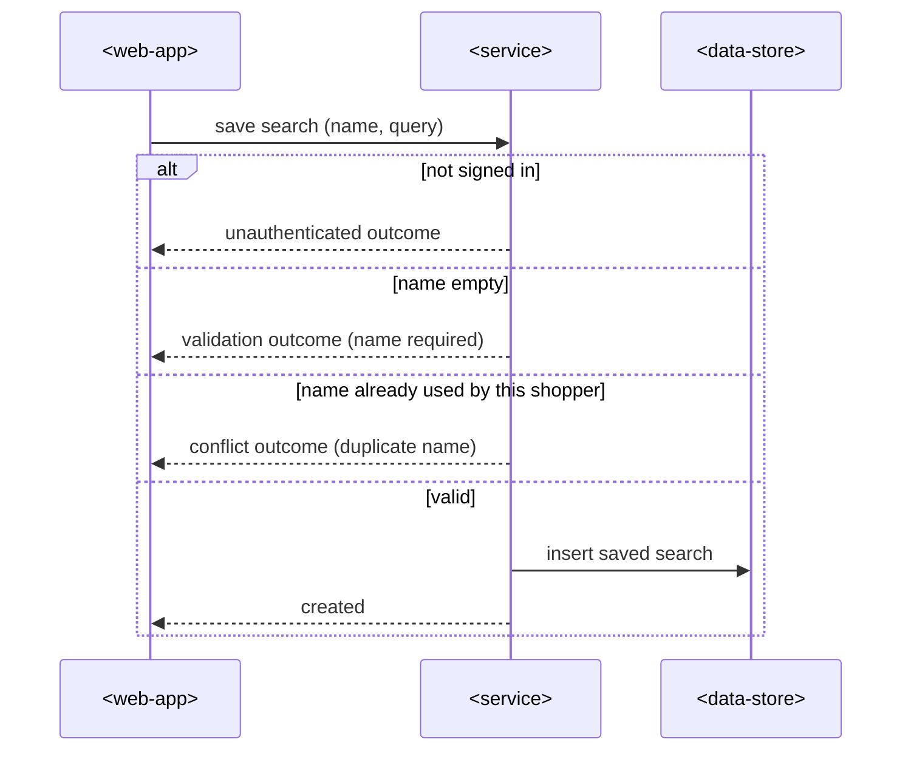
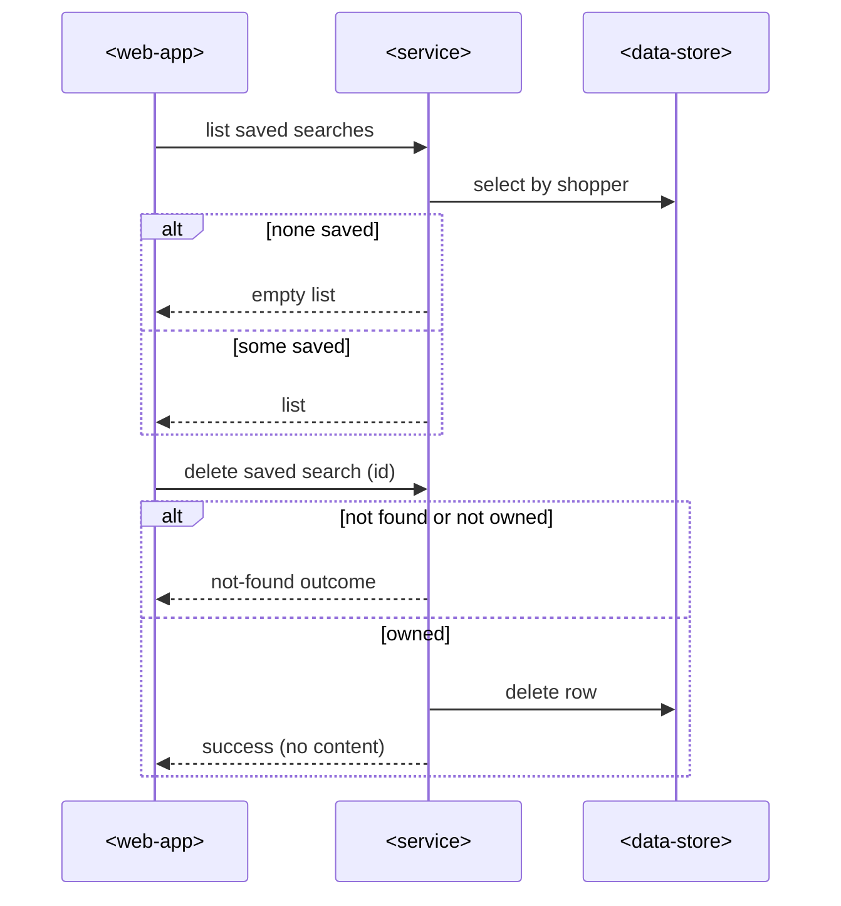

# SAD — saved-searches

## 1. Introduction & goals

Let a signed-in shopper save, list, re-run and delete product searches. Extends the existing
storefront backend and the mobile-first web app.

## 2. Constraints

Existing service; REST under `/api/v1`; session-cookie auth; the web app is the only client.

## 3. Context & scope

<!-- N/A: no new external actors — the existing web app calls the existing service. -->

## 4. Solution strategy

Target surfaces: `backend-service` (existing) + `web-frontend` (existing storefront app). A new
`savedsearch` module behind three endpoints; the web app adds a save sheet on the search results
screen and a saved-searches list screen.

## 5. Building blocks

- `savedsearch` module — handler → service → repo; owns the `saved_searches` table.
- Web app — search results screen (gains a «Save search» action), save sheet, saved-searches list.

## 6. Runtime

### Save a search

### List and delete saved searches

## 7. Deployment

<!-- N/A: reuses the existing deployment units. -->

## 8. Crosscutting

Neutral error codes (`saved_search.name_required`, `saved_search.duplicate_name`,
`saved_search.not_found`); session-cookie auth.

## 9. Architecture decisions

No blast-radius decisions — inline: hard delete, per-shopper unique name constraint.

## 10. Quality requirements

Saved-searches list renders content in ≤ 1 s p95 on a mid-range phone (spec §6).

## 11. Risks

| Risk | Severity | Mitigation |
|---|---|---|
| Accidental delete | low — accepted | confirm step before delete (AC-6) |

## 12. Glossary

Saved search — a named, re-runnable set of search filters owned by one shopper.
