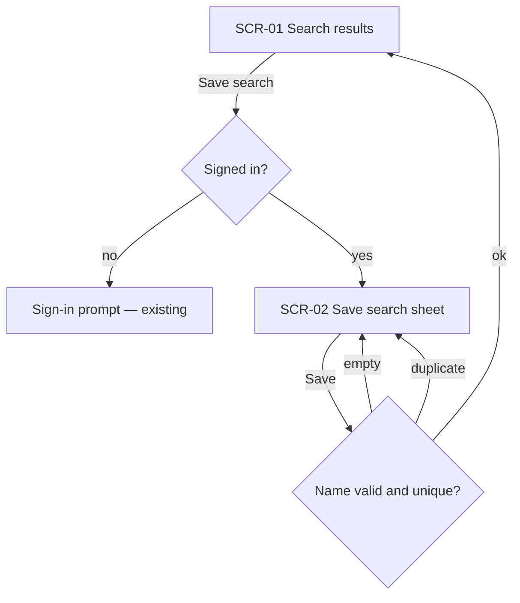
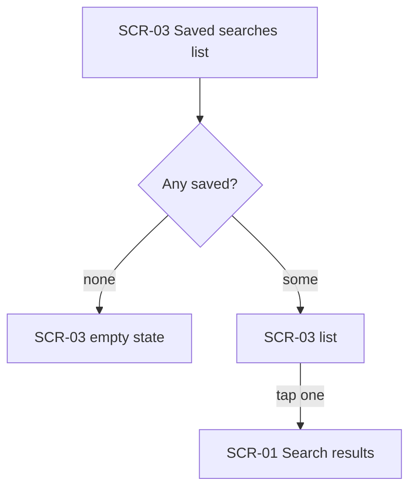
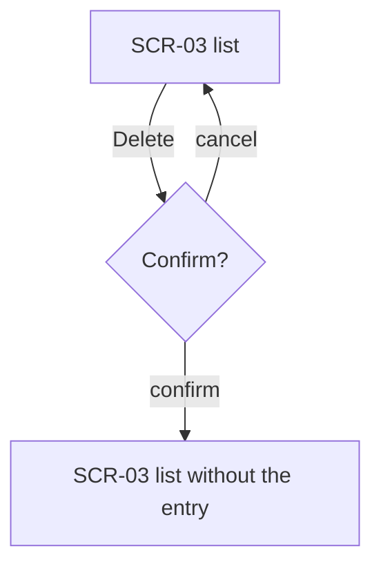

# UX flows — saved-searches

## Platform decisions

- **Posture:** mobile-first — per design-system.
- Save is a bottom sheet over the results, not a separate page.

## Screen inventory

| ID | Screen | Purpose | Entry | Exit |
|---|---|---|---|---|
| SCR-01 | Search results | Shows results; offers «Save search» | search bar | SCR-02, sign-in |
| SCR-02 | Save search sheet | Name and save the current search | SCR-01 «Save search» | SCR-01 |
| SCR-03 | Saved searches list | List, re-run and delete saved searches | account menu | SCR-01 (re-run) |

## Flows

### Flow: US-1 — save a search

Tapping «Save search» on the results asks a guest to sign in (AC-3); a signed-in shopper gets the
save sheet. An empty name (AC-2) or a duplicate (AC-4) keeps the sheet open with a message; a
valid name saves and returns to the results (AC-1).

### Flow: US-2 — see and re-run

The list shows an empty state when nothing is saved (AC-5); tapping an entry re-runs it.

### Flow: US-3 — delete

Delete asks for confirmation, then removes the entry (AC-6).

## AC coverage

| AC | Shown by | Notes |
|---|---|---|
| AC-1 | US-1 → D ok | |
| AC-2 | US-1 → D empty | |
| AC-3 | US-1 → B no | |
| AC-4 | US-1 → D duplicate | |
| AC-5 | US-2 → B none | |
| AC-6 | US-3 → C confirm | |
