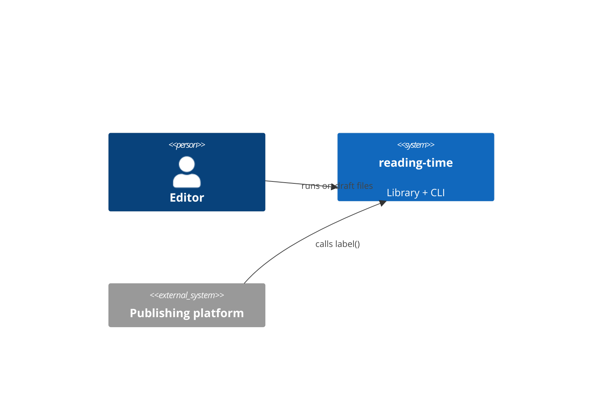
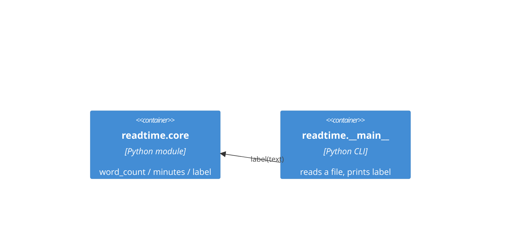

# Software Architecture Document — reading-time

## 1. Introduction and goals

**Intent.** A reading-time estimate for articles, usable as a library call by the platform and as
an editor command over draft files (spec §2).

**Top quality goals:** predictability (same text → same label), simplicity, speed (spec §6).

## 2. Constraints

- Python standard library only — editors run it on stock laptops with no package installs.

## 3. Context and scope

## 4. Solution strategy

A pure function of the text: count words, divide by a fixed speed, round up (ADR-0001). A thin CLI
wraps the library.

## 5. Building block view

## 6. Runtime view

<!-- N/A: single synchronous call, no multi-step flow (route quick) -->

## 7. Deployment view

<!-- N/A: shipped as a module inside the editorial tools repo; no separate deployment -->

## 8. Cross-cutting concepts

- Errors: the CLI maps an unreadable file to exit status 1 with a stderr message (AC-04).

## 9. Architecture decisions

- [ADR-0001](./adr/0001-fixed-words-per-minute.md) — fixed 200 words per minute, rounded up.

## 10. Quality requirements

- An estimate for a 10,000-word article returns in under 50 ms on an editor laptop.

## 11. Risks and technical debt

- Word counting on whitespace undercounts CJK text — out of scope (spec §3).

## 12. Glossary

<!-- N/A: no domain terms beyond the spec -->
