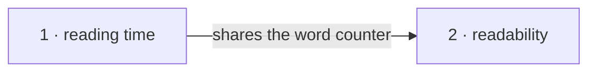

# Roadmap — editorial-tools

> **A decomposition, not a promise.** The overall idea broken into incremental steps: what each
> step is, where it comes from, how big it is — or that nobody has looked at it yet — and in which
> order, and parallel lanes, we walk them. **No dates** (except shipped history), **no scores** —
> order is the prioritization. The *solution* for any step lives in its `docs/features/<slug>/`
> spec, not here.

## Destination

Editors prepare every article — length, readability and metadata — from the command line before
it reaches the platform.

## Steps

| # | Step | Source | Size | Status |
|---|---|---|:---:|---|
| 1 | Readers see a reading-time label on every article → [`docs/features/reading-time/`](features/reading-time/spec.md) | editorial brief §2 | S | building |
| 2 | Editors get a readability score for a draft | editorial brief §3 | M | idea |

## Not yet specified

(none)

## Out of scope

- Publishing directly from the CLI — the platform owns publishing.

## Open decisions

(none)

## Decisions so far

- Fixed 200 wpm, rounded up → [`ADR-0001`](features/reading-time/adr/0001-fixed-words-per-minute.md)

## Dependency graph

## Execution path

| Wave | Steps | Zone per step (why parallel-safe) | Unlocks |
|:---:|---|---|---|
| 1 | 1 | `readtime/` | 2 |
| 2 | 2 | `readability/` (new) | — |

## Shipped

| Step | Shipped | Link |
|---|---|---|
